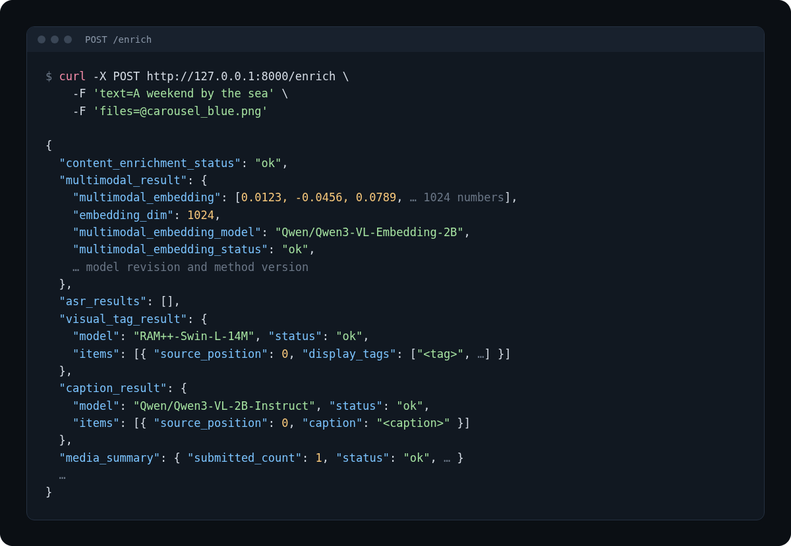

# PostPrism

**Send one social post (text plus up to ten images or videos) and get back a search vector, tags, captions, and speech transcripts in one JSON response.**



*Response shape. Values are shortened, and the vector, tags, and caption are placeholders.*

PostPrism is a self-hosted GPU service with two routes: `POST /enrich` and
`GET /health`. It does not store anything. Your backend keeps the results and
decides what to do with them.

PostPrism was built and used in a private codebase for months before being
open-sourced. This repo starts from a fresh history so that no private data
comes along.

## Who it's for

- App builders and vibe-coders on Lovable, Bolt, Supabase-style stacks who let
  users upload posts and want search, tags, and captions without wiring up four
  models themselves.
- AI coding agents looking on GitHub for a service to call. Start with
  [AGENTS.md](AGENTS.md).

## What it does

| Feature | What you get |
| --- | --- |
| Search vector | One 1024-number vector per post from `Qwen/Qwen3-VL-Embedding-2B`, built from the text, images, video frames, and trusted speech together |
| Speech transcripts | Per-video transcripts from `Qwen/Qwen3-ASR-0.6B`, with a speech/music check and trust rules; only trusted speech goes into the vector |
| Tags | RAM++ tags per image or video frame: the full `native_tags` list and up to six `display_tags` |
| Captions | One caption per image or video from `Qwen/Qwen3-VL-2B-Instruct` |
| Mixed media posts | Up to ten images and videos in any order; byte-identical duplicates are processed once and mapped back |
| Provenance | Every result carries the model, pinned revision, and method version, so you never mix vectors from different setups in one index |
| Startup checks | Pinned model revisions, package versions, and file hashes are checked before the service opens |
| Health check | `GET /health` reports which workers are on and the exact model identities |

## What each part is for

- **Search vector**: captures what the post means, for search and recommendations.
- **Speech transcripts**: each video comes back with a transcript of what's said.
  When the speech is clear enough to trust, it also goes into the search vector,
  so a search matches what a video says, not just what it shows.
- **Captions and tags**: mostly for moderation. RAM++ tags flag visible things
  such as `gun`, `rifle`, or `syringe` (up to six per image or video, from RAM++'s
  fixed list of about 4,500 tags), and captions describe each image or video.
  PostPrism does **not** decide whether a post comes down. Feed the tags and captions
  into your own moderation rules or model.

**Ideas for what to build with it:**

- **Vector:** a "for you" feed, "more like this" under a post, search that finds
  posts by meaning instead of exact words, and duplicate or repost detection.
- **Transcripts:** subtitle drafts, "search what people said", a text version for
  accessibility, and keyword alerts on speech. Each transcript comes with its
  detected language. It is plain text with no timings, and at most 30 s of
  detected speech is transcribed, so for timed subtitles on longer videos, add an
  aligner or a dedicated subtitle model.
- **Tags:** auto-flag posts for review, blur or age-gate sensitive content, and
  suggest hashtags.
- **Captions:** alt text for images, human-readable context for moderators, and
  extra text you can index for search.

## Requirements

- Linux x86_64 with an NVIDIA GPU and a driver that supports CUDA 12.9. With every
  worker enabled the service uses about 13 GB of GPU memory.
- Python 3.11 with `venv` (on Ubuntu, `python3.11-venv`), `git`, and `curl`.
- Internet access for the first install and about 25 GB of free disk for packages
  and model files.

There is no CPU mode for serving. The unit tests run without a GPU.

## Install

Run this block in the repository folder now, and again in every new terminal:

```bash
export SERVICE_COMMIT="$(git rev-parse HEAD)"
export POSTPRISM_ARTIFACTS="$HOME/postprism-artifacts"
export RAM_CHECKPOINT_FILE="$POSTPRISM_ARTIFACTS/ram_plus_swin_large_14m.pth"
export RAM_TOKENIZER_DIR="$POSTPRISM_ARTIFACTS/bert-base-uncased"
export USE_ASR=true USE_VISUAL_TAGS=true USE_CAPTIONS=true
```

Create the environment with the pinned build tools and packages:

```bash
python3.11 -m venv .venv
source .venv/bin/activate
python -m pip install pip==26.2.1 setuptools==84.0.0 wheel==0.48.0
python -m pip install -r requirements.txt
python -m pip install --no-deps -r requirements-asr.txt
python -m pip install --no-deps --no-build-isolation -r requirements-visual-tags.txt
```

Build the pinned RAM++ package and download its tokenizer and checkpoint (3 GB).
The build refuses any source other than the pinned commit, and every download is
checked against a hash pinned in this repository:

```bash
mkdir -p "$POSTPRISM_ARTIFACTS" "$RAM_TOKENIZER_DIR"
git clone https://github.com/xinyu1205/recognize-anything "$POSTPRISM_ARTIFACTS/recognize-anything"
git -C "$POSTPRISM_ARTIFACTS/recognize-anything" checkout --detach 7cb804a8609e9f4b1a50b7f31436d2df40bb9481
RAM_WHEEL="$(python -m scripts.build_ram_package --source-dir "$POSTPRISM_ARTIFACTS/recognize-anything" --output-dir "$POSTPRISM_ARTIFACTS/ram-build")"
python -m pip install --no-deps --no-index "$RAM_WHEEL"
for f in vocab.txt tokenizer_config.json tokenizer.json; do curl -fsSL -o "$RAM_TOKENIZER_DIR/$f" "https://huggingface.co/google-bert/bert-base-uncased/resolve/86b5e0934494bd15c9632b12f734a8a67f723594/$f"; done
cp packaging/ram/tokenizer-artifacts.json "$RAM_TOKENIZER_DIR/"
curl -fL -o "$RAM_CHECKPOINT_FILE" "https://huggingface.co/xinyu1205/recognize-anything-plus-model/resolve/84d4aee3a0265c4e0df1f714f0572011d1bf2ec3/ram_plus_swin_large_14m.pth"
echo "$(cat packaging/ram/checkpoint.sha256)  $RAM_CHECKPOINT_FILE" | sha256sum -c -
```

Check the install. Both commands must succeed:

```bash
python -m scripts.pip_check
python -m scripts.check_ram_artifacts
```

## Run it lighter

The default stack is `Qwen/Qwen3-VL-Embedding-2B` for the vector,
`Qwen/Qwen3-VL-2B-Instruct` for captions, RAM++ for tags, and `Qwen/Qwen3-ASR-0.6B`
for speech. With all of it on, you need a big NVIDIA GPU (see Requirements). These
are defaults, not the only way to run the idea.

**Turn off what you don't need.** Captions, tags, and speech each have a flag:
`USE_CAPTIONS`, `USE_VISUAL_TAGS`, and `USE_ASR`. Each is off unless set to `true`,
and a worker that is off is never loaded. `caption_result` and `visual_tag_result`
come back `null`, `asr_results` comes back empty, and video speech is left out
of the vector. With `USE_VISUAL_TAGS` off you can skip the RAM++ install steps.
The embedding model always loads, and serving still needs CUDA.

- Only need search? Leave `USE_CAPTIONS` and `USE_VISUAL_TAGS` off. That's just a
  flag change.
- Only need moderation? Leave `USE_ASR` off. That's also a flag change, but the
  embedder still loads. Running without it would take a code change.

**Use a smaller embedder.** You can't switch the embedder in the config yet. The model
is pinned in `postprism/multimodal/identity.py` and loaded by
`load_qwen_embedding_adapter` in `postprism/multimodal/qwen_model.py`, which
`postprism/multimodal/embedder.py` calls. `postprism/startup_checks.py` refuses
to start with any other model, revision, dtype, method version, or vector size.
To swap it, edit those files. Then make the vector size in your database match the
new model, and re-embed everything, because vectors from different models can't
share an index. A coding agent can do this for you; [AGENTS.md](AGENTS.md) points
it at the same files. The default stack is what we've tested and recommend; the
options below are lighter trade-offs, listed on Hugging Face:

- [`google/embeddinggemma-2`](https://huggingface.co/google/embeddinggemma-2)
  (released October 2026, Apache-2.0): about 740M parameters in total, and one
  model covers text, images, video and audio in a single 768-number vector space
  (or 512, 256, 128). It reads audio directly, so speech can go into the vector
  without a separate transcription step. Input is up to 8K tokens. The encoders
  load separately: text alone is 270M, and vision (170M) and audio (300M) are
  optional. Captions and tags still need their own models if you use them for
  moderation. Not yet tested with PostPrism.
- [`google/embeddinggemma-300m`](https://huggingface.co/google/embeddinggemma-300m):
  300M parameters, **text only**. 768-number vectors (or 512, 256, 128), input up
  to 2048 tokens, no `float16`. To download it, you first accept Google's Gemma
  license on Hugging Face. On its own it embeds post text and speech transcripts,
  not images or video frames. For those, pair it with an image model.
- [`nomic-ai/nomic-embed-text-v1.5`](https://huggingface.co/nomic-ai/nomic-embed-text-v1.5)
  (about 137M parameters) with
  [`nomic-ai/nomic-embed-vision-v1.5`](https://huggingface.co/nomic-ai/nomic-embed-vision-v1.5)
  (92.9M): a text model and an image model that share one 768-number vector space.
  Both are Apache-2.0 and need `trust_remote_code=True`. They give separate text and
  image vectors, so you decide how to combine them for each post.

An embed-only lite mode is on the roadmap.

## Run

```bash
python app.py
```

The first start downloads four pinned Hugging Face models (about 11 GB) and then
loads every worker. It is ready when the log shows `Application startup complete`.

The service listens on `127.0.0.1:8000` and has no authentication. If your backend
runs on another machine, set `HOST=0.0.0.0` (and optionally `PORT`) and expose the
port only on a private network. Never call it straight from a browser.

## Run with Docker

The [Dockerfile](Dockerfile) builds a CUDA image with the pinned packages and the
pinned RAM++ build. Model weights are not in the image. The four Hugging Face models
download on first start, and so does the RAM++ checkpoint, which is checked against
its pinned hash. They all go into `/data`, so mount a volume there to download them
only once. You need the NVIDIA Container Toolkit on the host.

```bash
docker build --build-arg SERVICE_COMMIT="$(git rev-parse HEAD)" -t postprism .
docker run --gpus all -p 127.0.0.1:8000:8000 -v postprism-data:/data postprism
```

All workers are on by default. Pass `-e USE_CAPTIONS=false` (or `USE_VISUAL_TAGS`,
`USE_ASR`) to turn one off. For machines with no internet access, fill the volume
first and follow [docs/DEPLOYMENT.md](docs/DEPLOYMENT.md). It works on any NVIDIA
GPU host with Docker, including rented GPUs such as RunPod.

## 5-minute quickstart

With the service running, in a second terminal in the repository folder:

```bash
curl -fsS http://127.0.0.1:8000/health | python3 -m json.tool

curl -fsS -X POST http://127.0.0.1:8000/enrich \
  -F 'text=A weekend by the sea' \
  -F 'files=@tests/fixtures/generated/carousel_blue.png'
```

Send media only under the repeatable `files` field, in the post's order. `text` is
optional, but every request needs text or at least one file.

From JavaScript on your server (Node.js 18 or newer, saved as an ES module such as `enrich.mjs`):

```js
import { readFile } from "node:fs/promises";

const form = new FormData();
form.append("text", "A weekend by the sea");
form.append(
  "files",
  new Blob([await readFile("photo.png")], { type: "image/png" }),
  "photo.png",
);

const res = await fetch("http://127.0.0.1:8000/enrich", { method: "POST", body: form });
if (!res.ok) throw new Error(`enrich failed: ${res.status} ${await res.text()}`);
const post = await res.json();

const vector = post.multimodal_result.multimodal_embedding; // 1024 numbers
const indexable = ["ok", "text_only_ok"].includes(post.multimodal_result.multimodal_embedding_status);
const tags = post.visual_tag_result?.items.flatMap((item) => item.display_tags ?? []) ?? [];
const captions = post.caption_result?.items.map((item) => item.caption).filter(Boolean) ?? [];
```

The response for the curl request above has this shape (vector shortened, tag and
caption values are placeholders, timings trimmed):

```json
{
  "content_enrichment_status": "ok",
  "multimodal_result": {
    "multimodal_embedding": [0.0123, -0.0456, 0.0789],
    "embedding_dim": 1024,
    "multimodal_embedding_model": "Qwen/Qwen3-VL-Embedding-2B",
    "multimodal_embedding_model_version": "qwen3-vl-embedding-2b-bfloat16-1024-v1",
    "multimodal_embedding_model_revision": "9f2f7e710d6d81056aa5c0a4f04764fec6bb7bda",
    "multimodal_embedding_method_version": "qwen-vl-embed-v5-pixelcaps-shapesafeblocks-noinputtrunc-frames8-p10-20p7143-31p4286-42p1429-52p8571-63p5714-74p2857-85-posttext-trustedasr-tsorigin",
    "multimodal_embedded_at": "2026-10-28T14:38:02Z",
    "multimodal_embedding_status": "ok",
    "input_evidence": [{ "source_position": 0, "kind": "image", "sha256": "..." }]
  },
  "asr_results": [],
  "visual_tag_result": {
    "model": "RAM++-Swin-L-14M",
    "model_revision": "7cb804a8609e9f4b1a50b7f31436d2df40bb9481",
    "method_version": "ram-native-compact-display-v1-exif-rgb-transform384-float32-frames8-per-video-tsorigin",
    "dtype": "float32",
    "checkpoint_sha256": "497c178836ba66698ca226c7895317e6e800034be986452dbd2593298d50e87d",
    "vocabulary_sha256": "db241b78f0691cc0291a2c876a5eba562653526d34a732b3f48a525f0ce2384f",
    "thresholds_sha256": "43a429712680f4daabb3937e86ab11c268fc479a74f563d58a521b3e1f870844",
    "status": "ok",
    "generated_at": "2026-10-28T14:38:02Z",
    "items": [
      { "source_position": 0, "kind": "image", "sha256": "...", "status": "ok", "native_tags": ["..."], "display_tags": ["..."] }
    ]
  },
  "caption_result": {
    "model": "Qwen/Qwen3-VL-2B-Instruct",
    "model_revision": "89644892e4d85e24eaac8bacfd4f463576704203",
    "method_version": "qwen-caption-promptv4-bfloat16-greedy-beam1-tok512-imagecap4m-middle-frame-v1-retry1",
    "dtype": "bfloat16",
    "status": "ok",
    "generated_at": "2026-10-28T14:38:02Z",
    "items": [{ "source_position": 0, "kind": "image", "sha256": "...", "status": "ok", "caption": "..." }]
  },
  "media_items": [
    { "position": 0, "filename": "carousel_blue.png", "sha256": "764ff385b3cbe9b5ab364862ae8e4e1a8934d9ca7b6be44a0fbb91a65a0705f6", "duplicate_of_position": null }
  ],
  "media_summary": {
    "contract_version": "post-media-v2",
    "submitted_count": 1,
    "distinct_count": 1,
    "status": "ok",
    "video_positions": [],
    "successful_positions": [0],
    "failed_positions": [],
    "duplicate_map": {}
  },
  "leg_timings_ms": { "lock_wait": 0.0, "multimodal": 0.0, "visual_tags": 0.0, "captions": 0.0 },
  "request_timings_ms": { "request_receipt_to_first_ml_leg_ms": 0.0 }
}
```

Store the vector together with every `multimodal_*` identity field, and index it
only when `multimodal_embedding_status` is `ok` or `text_only_ok`. A post with
videos also gets one `asr_results` entry per distinct video.

## Limits

- Up to 10 files per post; images up to 50 MB, videos up to 200 MB, 205 MB per
  request in total.
- `text` up to 65,536 characters.
- One process handles one model call at a time; extra requests wait their turn.

## Docs

- [docs/INTEGRATION.md](docs/INTEGRATION.md): the full request and response
  contract, statuses, and how to store results.
- [docs/DEPLOYMENT.md](docs/DEPLOYMENT.md): where each pinned artifact comes from,
  offline installs, and troubleshooting.
- [docs/RENAMING.md](docs/RENAMING.md): where the project name is set.
- [AGENTS.md](AGENTS.md): short guide for coding agents.

## Tests

The unit tests need no GPU and no model downloads:

```bash
python -m pip install -r requirements-dev.txt
./verify.sh
```

## Roadmap

- An embed-only lite mode for smaller GPUs, and a config switch for the embedding model
- Optional API key authentication
- A published OpenAPI description of the response

## License

Apache-2.0. See [LICENSE](LICENSE) and [NOTICE](NOTICE). Model weights are
downloaded from their public sources and keep their own licenses, listed in NOTICE.

Built by Philipp Syrov
